  

### I translate cyber risk into decisions boards can act on.

Critical infrastructure · Hybrid & multi-cloud · SaaS · OT/ICS — continuous compliance with **ISO 27001 · SOC 2 · NIST · ISA/IEC 62443**, without disrupting operations.

---

### 🛰️ ORBIT — my proprietary security methodology

> Maturity is measured by outcomes and risk reduction — never by controls counted or tools deployed.

---

### ⚙️ Arsenal

  

---

### 🌐 Industry Engagement

| | Network | Since |
|:-:|:--|:-:|
| 🔷 | **Microsoft Entra Global Advisor** — strategic platform feedback from real implementations | 2025 |
| 🛡️ | **SANS CISO Network** — community of senior security leaders | 2025 |
| ☁️ | **Cloud Security Alliance** — cloud security assurance best practice | 2025 |
| 🟢 | **GDG Maputo** — partner, cybersecurity events & workshops | 2024 |
| 🇲🇿 | **MozDevz** — partner, teaching cybersecurity through community events | 2019 |

<b>🎙️ On air — 6 media & academic interviews</b>

 

| Outlet | Topic | Date |
|:--|:--|:-:|
| **STV** — Soico Televisão | The challenges of designing a cybersecurity program in an immature country | Jan 2023 |
| **TVM** — Televisão de Moçambique | The current scenario of Mozambican cybersecurity | Mar 2023 |
| **TTV** — A Tua Televisão | Attacks in Mozambique cyberspace | Apr 2023 |
| **UEM** — Universidade Eduardo Mondlane | Ways to protect yourself in cyberspace | May 2023 |
| **FTV** — F. Performance-Live | The impact of cybersecurity on our business | May 2023 |
| **ISPT** — Instituto Superior Politécnico de Tete | Cybersecurity fundamentals | Nov 2025 |

---

### 🧪 Projects

**🎓 Open Security** — cybersecurity internship program that has brought **400+ people** from Mozambique and abroad into the information security field.

---

<picture>
  <source media="(prefers-color-scheme: dark)"  srcset="https://raw.githubusercontent.com/arlindo0x73/arlindo0x73/output/snake-dark.svg"/>
  <source media="(prefers-color-scheme: light)" srcset="https://raw.githubusercontent.com/arlindo0x73/arlindo0x73/output/snake-light.svg"/>
  
</picture>

 

